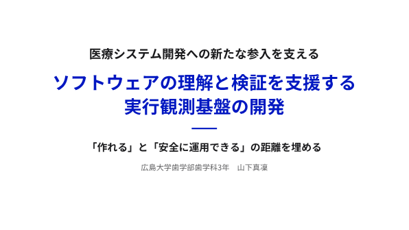
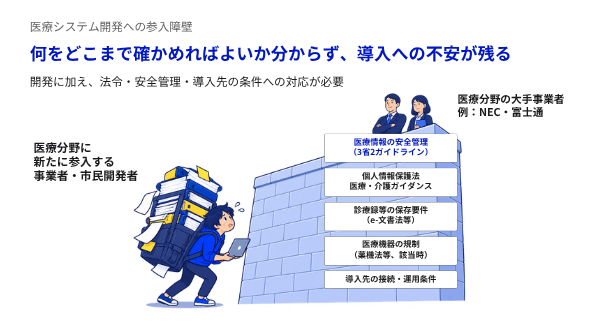
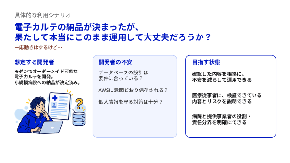
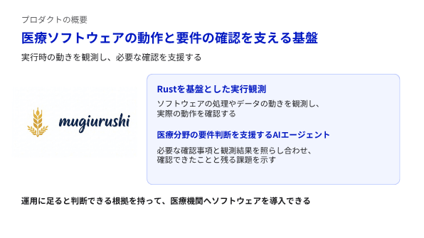
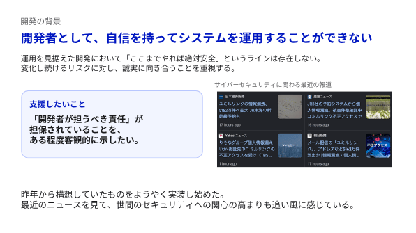
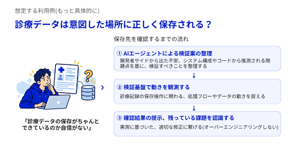
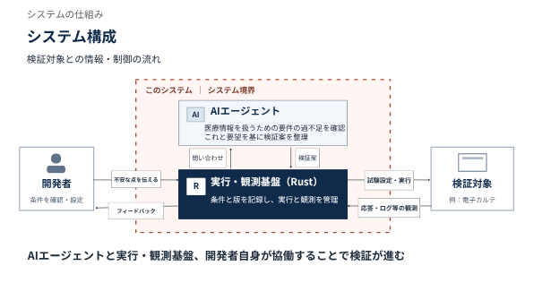
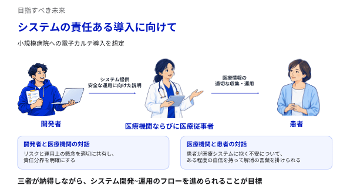

# 麦漆（mugiurushi）

**医療システムの開発者が、ソフトウェアの動作を理解し、検証するための実行観測基盤です。**

作ったシステムが想定どおりに動くか。障害が起きたとき、診療データはどうなるか。医療情報を扱うために、ほかに何を確かめる必要があるか。麦漆は、こうした問いを検証できる形に整理し、実際の動作とその根拠を記録することを目指しています。

## 開発の背景

医療システムを提供するには、機能を開発するだけでなく、医療情報の保護、診療記録の保存、障害時の対応、導入先の運用条件など、幅広い事項を考える必要があります。適用される法令やガイドライン、医療機関との役割分担も、対象となるシステムに応じて確認しなければなりません。

新たに医療分野へ参入する開発者にとっては、何を、どこまで、どのように確かめればよいかを把握すること自体が負担になります。生成AIなどによってソフトウェアを作る方法が広がる中でも、作ったものを理解し、運用に向けて検証する作業は欠かせません。

麦漆は、その検証を進めるために必要な知識や作業を支援し、**医療システム開発への参入障壁を下げる**ことを目指しています。確認すべき事項を省くのではなく、開発者が必要な確認に取り組み、その結果を説明できるようにしたいと考えています。

## 麦漆が支援したいこと

麦漆の主な利用者は、医療システムを開発・提供する人です。コードやシステムの構成を調べ、正常時や障害時の動作を確かめ、確認できたことと残る課題を整理します。

例えば、開発した電子カルテを医療機関に納品する前に、「入力した診療記録は正しい患者に保存されるか」「保存中にデータベースが停止したら何が残るか」を確かめたいとします。開発者は対象の構成を調べたうえで、期待する結果と観測方法を決め、試験環境で操作や障害を再現します。麦漆はその実行条件と結果を対応づけて記録し、改修後の再検証や比較を支援します。

目指すのは、開発者が確認の根拠を持ち、残っている課題や運用上の懸念を医療機関に説明できる状態です。開発者と医療機関が役割や責任の分担を話し合う際にも、検証結果を使えるようにしたいと考えています。

## 仕組み

麦漆は、AIによる調査の支援と、Rustで作る実行・観測基盤を組み合わせます。

1. **構成を調べる**：公開GitHubリポジトリのコードを読み、AIが構成図の生成や疑問の整理を支援します。
2. **検証を設計する**：開発者が確認したい動作、期待する結果、観測方法を決めます。
3. **実行して観測する**：試験環境で対象を動かし、応答、画面表示、ログ、データの保存状態などを記録します。
4. **結果を確認し、再検証する**：期待と実際の結果を照らし合わせ、対象の版や条件とともに残します。改修後は以前の試行と比較できます。

構成図を使わず、検証内容を直接設定することもできます。AIの説明と実際に得られた観測は区別し、証拠が足りない場合は判定不能として扱います。

将来は、医療情報を扱うための要件と検証結果を照らし合わせ、必要な確認事項や残る課題を整理するAIエージェントの活用も目指しています。

## 開発状況

現在は、公開リポジトリからの構成図生成、試験条件の設定、対象の実行と観測、結果の記録・比較を実装しています。コンテナを対象とした通信の集計や、データベースの故障を解除した後の読み出しの比較にも取り組んでいます。

医療系OSSを使った検証例として、OpenEMRでは架空の患者データを用い、診療記録の保存・再表示・データベースの読み出しを確認しました。保存直前にデータベースを停止した試行と、再起動後の読み出しも記録しています。OHIF ViewerのビルドとMONAIの合成画像推論も試験しています。

これらは特定の版と条件での検証例です。患者間の記録の混同や権限のない更新を確かめるシナリオは、[今後のデモ案](https://github.com/Suisan-neki/mugiurushi/issues/192)として検討しています。

医療情報のガイドライン全体への自動適合判定や、医療機関への導入可否の保証は実現していません。また、実医療機関での有効性や、検証の負担をどの程度減らせるかは今後の評価課題です。

## 発表資料

開発の背景、利用シナリオ、システム構成と目指す将来像をまとめています。以下は2026年10月27日時点の資料です。

[Canvaで発表スライドを開く](https://www.canva.com/d/J7Dam58VLXlW6Ue)

## 名前について

麦漆は金継ぎで接着に使う材料です。対象の版・検証条件・実行記録を対応づけ、変更した経緯を次の検証や改修へ引き継ぐという考えを名前に重ねています。

## 関連資料

- [現在の対象・目的・評価方針](docs/developer-verification.md)
- [OpenEMRでの試験記録](docs/validation-pr-187-190-2026-10-26.md)
- [OHIF Viewer・MONAIの固定環境](docs/pinned-environments.md)
- [開発・実行の手引き](docs/development-guide.md)
